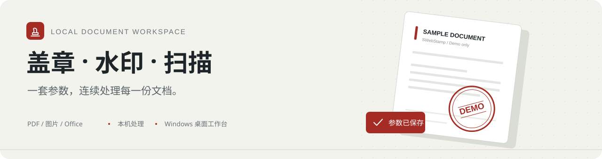
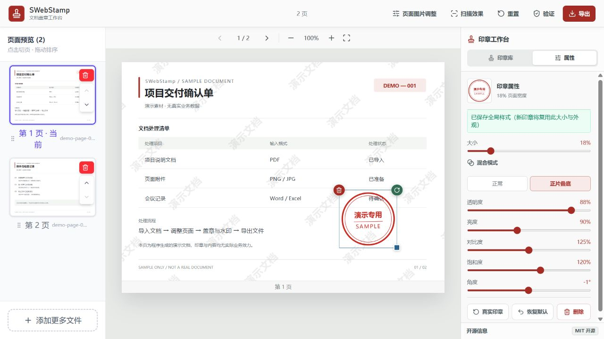
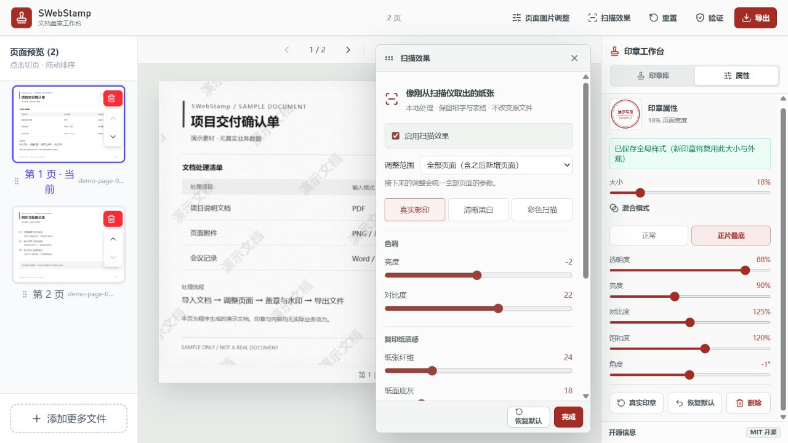

<div align="center">

# SWebStamp

**本地文档盖章工作台**

PDF、图片与 Office 文档，从导入到盖章、水印和扫描件效果，再到导出。

[](https://github.com/chichenji/SWebStamp/releases/latest)
[](https://github.com/chichenji/SWebStamp/releases/latest)
[](LICENSE)

**[下载 Windows 安装包](https://github.com/chichenji/SWebStamp/releases/download/v1.4.3/SWebStamp.Setup.1.4.3.exe)** · [快速上手](#快速上手) · [使用手册](USER_GUIDE.md) · [问题反馈](https://github.com/chichenji/SWebStamp/issues)

</div>



SWebStamp 将文档预览、印章、水印和页面处理集中在一个桌面工作台。拖入文件即可开始编辑，印章与水印的常用参数会保存在本机，便于连续处理多份文件。

> **1.4.3 已发布**：新增跨文件通用的印章与水印参数记忆，包含整行水印旋转、长文字裁切修复、页面图片调整及 MIT 开源说明。[查看完整更新记录 →](docs/CHANGELOG.md)

## 界面预览



<details>
<summary><strong>查看扫描件效果与纸张设置</strong></summary>



</details>

<sub>截图来自实际应用；文档、内容与印章均为专门制作的演示素材，不包含私人文件。</sub>

## 功能概览

| 模块 | 支持能力 |
| --- | --- |
| 文档与页面 | PDF、图片、Office 导入；缩略图切页与页面排序 |
| 印章 | 拖放、缩放、旋转、骑缝章、正片叠底 |
| 水印 | 文字 / 图片、单行 / 阵列、整行角度与间距 |
| 参数记忆 | 跨文件复用大小、角度与外观；重启后保留 |
| 扫描件效果 | 黑白影印、彩色扫描、纸纹、颗粒、阴影与 A4 适配 |
| 页面图片 | 亮度、对比度、饱和度、去色、反相与复古色调 |
| 文件导出 | 多页 PDF、逐页图片、质量选择与本地导出记录 |

### 一次调整，后续复用

- **印章**：保存通用的大小、旋转、透明度、亮度、对比度、饱和度和混合模式，换文件或换素材时继续使用。
- **水印**：保存文字或图片、字号、角度、颜色、间距、位置与启用状态。移除水印保留参数，之后可重新应用。
- **尺寸**：印章大小按页面宽度比例记录，特殊宽高比素材等比适配页面。文档上的盖章坐标属于当前会话。

## 下载与安装

**适用平台：Windows x64。** 普通用户下载 `.exe` 安装器即可，无需配置 Node.js 开发环境。

- [**下载 1.4.3 安装包**](https://github.com/chichenji/SWebStamp/releases/download/v1.4.3/SWebStamp.Setup.1.4.3.exe)
- [全部版本与 SHA-256 校验文件](https://github.com/chichenji/SWebStamp/releases)
- [安装、覆盖升级与验证说明](docs/releases/1.4.3.md)

安装前先导出当前文档并关闭旧版，在同一 Windows 用户账号下运行安装器。Squirrel 版 1.3.0 至 1.4.2 的覆盖升级计划已验证，无需先卸载；尚未在用户现有安装上执行实际升级。当前不提供联网自动更新。

安装器未数字签名，Windows 可能显示未知发布者提示。旧 NSIS、Inno Setup 和绿色版的跨安装器迁移未验证。

**Office 转换需要本机 LibreOffice。** 纯 PDF 与图片处理不需要 LibreOffice；首次下载转换组件需要网络。

## 快速上手

1. **导入文件**：将 PDF、图片或 Office 文档拖入工作台，通过左侧缩略图切换和整理页面。
2. **拖放盖章**：添加印章素材，将其拖到文档目标位置，再调整大小、角度与外观。
3. **设置页面**：按需添加水印、调整底图或启用扫描件效果。水印配置完成后点击“应用水印”。
4. **导出结果**：选择 PDF 或逐页图片，设置质量后导出。关闭工作台前，请先导出正在编辑的文档。

更多操作见 [使用指南](USER_GUIDE.md)，包括骑缝章、单行水印、A4 适配、原图对比和常见问题。

## 本地处理与隐私

- 文件合成与 Office 转换在本机完成；印章库和常用参数保存在当前设备，不提供云端素材同步。
- 本仓库仅公开源码、文档和演示素材；私人印章、用户文档、数据库、真实环境配置及本地开发记录均不入库。
- 页面内容、已放置印章、图片调整与扫描参数属于当前编辑会话，参数记忆不能替代文档保存。

<details>
<summary><strong>处理边界与安全说明</strong></summary>

- 页面经过栅格化再合成导出，不保证保留原 PDF 的可搜索文字、矢量结构、表单、书签或数字签名。
- 扫描件效果不包含 OCR，也不会恢复原文件中缺失的细节。
- 本地导出验证元数据不等于可信数字签名或防篡改认证。
- 当前 HTTP 服务没有登录门禁，应在可信本地环境中使用。完整边界见 [SECURITY.md](SECURITY.md)。

</details>

## 开发与构建

技术栈：**React 19 · Vite 7 · Electron 40 · Express · Canvas · PDF.js**。

<details>
<summary><strong>启动开发环境</strong></summary>

需要 Node.js 22.12+ 或 Node.js 24、npm。Office 转换另需 LibreOffice。

```powershell
git clone https://github.com/chichenji/SWebStamp.git
cd SWebStamp
npm ci
Copy-Item .env.example .env
```

编辑 `.env`，将 `JWT_SECRET` 设置为本机生成的随机值，再启动：

```powershell
npm run dev:all
```

前端通常为 `http://localhost:5173`，后端为 `http://localhost:3000`；端口占用时以 Vite 输出为准。不要提交真实 `.env`。

</details>

<details>
<summary><strong>运行检查与构建安装器</strong></summary>

```powershell
node node_modules/eslint/bin/eslint.js src scripts/watermark-browser-checks.js
$testFiles = @(rg --files src server electron -g '*.test.js')
node --test --test-timeout=60000 @testFiles
npm run build
```

测试覆盖安装事件、Office 转换、印章几何、扫描、水印排布、底图调整与参数持久化。1.4.3 发布前通过了 98 项 Node 测试。

Windows 安装器还需 .NET SDK 8 和本地 Electron 依赖：

```powershell
npm run dist
```

安装器和完整升级包输出到 `release/`。构建、包内校验与升级验证流程见 [构建与发布指南](docs/BUILDING.md)。

</details>

<details>
<summary><strong>项目目录</strong></summary>

```text
src/          前端工作台、状态管理与 Canvas 合成
server/       本地 Office 转换服务
electron/     桌面窗口、预加载与安装生命周期
scripts/      安装器构建、校验及浏览器回归
docs/         架构、发布文档与公开演示图片
```

依赖、运行时、用户数据和发布二进制不纳入源码仓库，安装包通过 GitHub Release 分发。

</details>

## 文档导航

[使用指南](USER_GUIDE.md) · [架构说明](docs/ARCHITECTURE.md) · [构建与发布](docs/BUILDING.md) · [更新记录](docs/CHANGELOG.md) · [安全说明](SECURITY.md) · [1.4.3 发布说明](docs/releases/1.4.3.md)

## 反馈与参与

欢迎通过 [GitHub Issues](https://github.com/chichenji/SWebStamp/issues) 报告问题或提出建议。反馈时请附上版本号、复现步骤和错误信息，并使用脱敏截图或演示文件。

## 开源授权

原创代码与文档采用 **[MIT License](LICENSE)**，Copyright © 2026 [chichenji](https://github.com/chichenji)。允许商业使用、修改与分发，需保留版权和许可声明；软件按原样提供，不作担保。

第三方依赖保留各自许可证。演示图片使用合成内容；项目授权不涵盖任何用户私人印章或上传文档。
